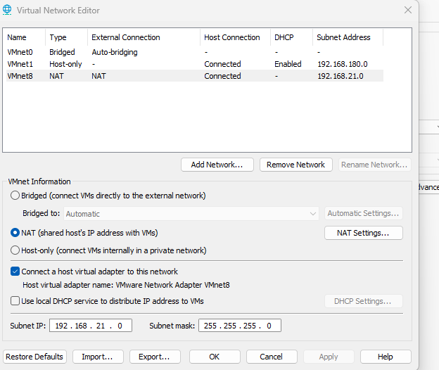
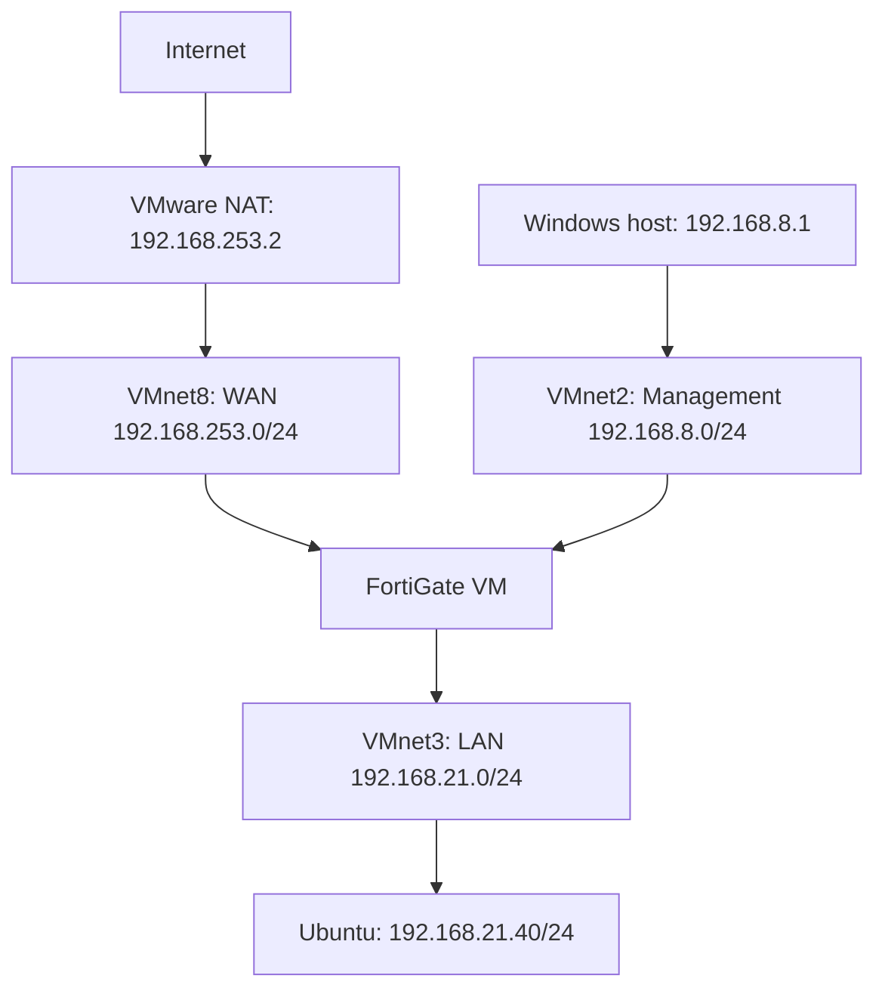

# FortiGate & VMware Workstation Lab Recovery

**Recovering a failed lab by reverse engineering VMware virtual networks from surviving FortiGate configuration.**

Author: Poul Mhiripiri · Incident date: 10 October 2026 · Environment: personal lab, VMware Workstation 17.x, FortiGate VM, Windows host, Ubuntu LAN VM.

## Engineering context

Systems can become unavailable for many reasons: configuration resets, upgrades, failed changes, host faults, or unexpected restarts. An engineer may inherit an environment without a usable network diagram or current recovery documentation. Recovery then depends on gathering evidence, understanding dependencies, forming testable hypotheses, and reconstructing the minimum configuration needed to restore services.

This case demonstrates that approach. The user reported that VMware networking had reset and the lab was no longer working. The FortiGate retained its interface configuration and routing information. These surviving records were used to reconstruct the VMware network configuration rather than rebuilding the firewall.

**Outcome:** management access and FortiGate internet connectivity were restored and verified. The Ubuntu LAN VM had a dynamic address and the intended default gateway. End-to-end LAN internet forwarding and DNS tests were proposed, but their results were not supplied in the captured evidence.

## The failure

The FortiGate VM still referenced VMnet2, VMnet8 and VMnet3, while VMware's Virtual Network Editor showed only VMnet0, VMnet1 and VMnet8. VMnet8 was using 192.168.21.0/24, conflicting with the surviving WAN configuration of 192.168.253.15/24 and gateway 192.168.253.2.

The observed configuration mismatch explains the missing connectivity. The precise event that reset VMware networking was not established; an upgrade or unsafe reboot must not be presented as a proven cause.

## Impact on dependent VMs

The outage also affected the lab VMs that depended on the VMware virtual networks and FortiGate. The owner confirmed that these VMs required connectivity to FortiGate to obtain DHCP addresses and used FortiGate as their default gateway for internet access.

The dependency was: **guest VM attachment → working VMnet segment → FortiGate LAN interface → DHCP and gateway services → WAN/NAT → internet**. Missing or incorrectly reconstructed virtual networks could therefore interrupt both address assignment and internet access, even when the guest operating systems and FortiGate configuration were intact. Restoring the shared network dependencies was necessary to restore the dependent workloads.

The available DHCP configuration identifies port3 on VMnet3 as the LAN DHCP segment. The evidence does not establish that every VM visible in the VMware inventory used this segment or record a recovery test for every dependent VM. Ubuntu is the documented client example; other affected VMs are part of the owner-reported impact.

## Reconstructing the intended design

| Surviving evidence | Engineering deduction | Recovery action |
|---|---|---|
| port1: 192.168.8.10/24, alias Management | Management belongs on 192.168.8.0/24 | Recreate VMnet2 as host-only |
| port2: 192.168.253.15/24, alias WAN | WAN belongs on 192.168.253.0/24 | Restore VMnet8 NAT subnet |
| Default route via 192.168.253.2 on port2 | Upstream next hop must be reachable on the WAN segment | Set VMware NAT gateway to 192.168.253.2 |
| port3: 192.168.21.10/24, alias LAN | LAN belongs on a separate 192.168.21.0/24 segment | Recreate VMnet3 as host-only |
| DHCP configuration on port3 with gateway 192.168.21.10 | FortiGate has the LAN DHCP role configured | Disable VMware DHCP on VMnet3 |
| VM adapter selections: VMnet2, VMnet8, VMnet3 | Existing VM attachment choices preserve clues to the topology | Retain the selections and adapter order |

Adapter-to-port correspondence was initially inferred from adapter order. Management and WAN recovery support the proposed mapping, but a MAC-address comparison was not captured. See the runbook for that verification method.

## Recovered topology

Host-only describes VMware's virtual segment. A LAN guest can still reach the internet through FortiGate when routing, firewall policy and source NAT permit it. Windows also had a VMnet3 host adapter; the diagram emphasises the recovery path rather than every host attachment.

## Troubleshooting stages

1. **Inspect the failed state:** compare VM network adapter selections with networks actually present in Virtual Network Editor.
2. **Read the surviving configuration:** collect FortiGate interfaces, static routes, routing table and DHCP configuration through the VM console.
3. **Reverse engineer the dependencies:** derive subnet boundaries and gateway from IP masks and the default route; identify management, WAN and LAN roles from aliases.
4. **Reconstruct VMware networking:** recreate VMnet2 and VMnet3, restore VMnet8 NAT settings, preserve existing FortiGate configuration and VM adapter attachments.
5. **Check the Windows host:** verify VMnet2 = 192.168.8.1/24, VMnet8 = 192.168.253.1/24 and VMnet3 = 192.168.21.1/24, with blank host-adapter gateways.
6. **Validate management and upstream connectivity:** reach the management login page, establish SSH, ping the VMware NAT gateway and external IPs.
7. **Restore dependent VM attachments and inspect a LAN client:** reconnect affected guests to their intended VMnet segments so they can reach FortiGate for DHCP and gateway services; confirm Ubuntu ens33 is up with 192.168.21.40/24 and default route through 192.168.21.10.
8. **Document residual checks:** LAN forwarding, DNS, HTTPS access, DHCP pool boundaries and the filesystem warning remain separate verification items.

## Validation results

| Check | Captured result | What it establishes |
|---|---|---|
| Management web page at 192.168.8.10 | Login page loaded over HTTP | Host-to-management web connectivity; successful GUI login not evidenced |
| SSH at 192.168.8.10 | Authenticated CLI session | Working management access |
| FortiGate → 192.168.253.2 | 2/2 replies, 0% loss | WAN next-hop reachability |
| FortiGate → 1.1.1.1 | 3/3 replies, 0% loss | FortiGate upstream IP connectivity |
| FortiGate → 8.8.8.8 | 2/2 replies, 0% loss | Additional upstream IP connectivity |
| Ubuntu ens33 | UP, dynamic 192.168.21.40/24 | LAN address consistent with intended subnet |
| Ubuntu default route | Via 192.168.21.10 | Intended client gateway installed |
| Ubuntu → gateway/internet/DNS/HTTPS | No test output supplied | Pending; not claimed as successful |

A dynamic address alone does not identify the issuing DHCP server. A lease record or fresh renewal with packet capture would provide stronger proof. FortiGate-originated ping also does not validate a LAN-to-WAN forwarding policy.

## Repository guide

- [Incident analysis](docs/incident-analysis.md): observations, hypotheses, impact and lessons.
- [Recovery runbook](docs/recovery-runbook.md): practical restoration and branching checks.
- [Evidence index](evidence/README.md): screenshot provenance and coverage.
- [FortiGate excerpts](configs/fortigate-observed.txt): partial transcription, not an importable backup.
- [Recovered network settings](configs/vmware-recovered.csv): topology inventory.
- [GitHub publishing instructions](docs/publish-to-github.md): repository name, description and upload workflow.

## Skills demonstrated

Network fault isolation; reverse engineering from device configuration; IPv4 subnetting; virtual network reconstruction; routing and NAT analysis; DHCP ownership checks; service validation; evidence-based incident documentation; and clear separation of proven results from assumptions.

## Lessons for service restoration

**Use the evidence that survives.** Device configurations, route tables, VM attachment settings and client routes can become a substitute for missing design records. Keep a change targeted, validate each dependency, and turn the recovery into documentation for the next engineer.

After recovery, retain configuration backups, export VMware's virtual network settings, record adapter MAC-to-port mappings, and document which component owns DHCP, NAT and DNS. Recovery under incomplete documentation should reduce future dependence on inference.

## Technical references

- [Broadcom: Using the Virtual Network Editor in VMware Workstation](https://knowledge.broadcom.com/external/article/339371/using-the-virtual-network-editor-in-vmwa.html)
- [Fortinet: CLI troubleshooting cheat sheet](https://docs2.fortinet.com/document/fortigate/7.4.0/cli-troubleshooting-cheat-sheet/420966/cli-troubleshooting-cheat-sheet)
- [Fortinet: Displaying detailed hardware NIC information](https://docs.fortinet.com/document/fortigate/8.0.0/administration-guide/306050/displaying-detail-hardware-nic-information)

Commands and menus can vary by release. The installed FortiOS version was not captured. This is a personal lab case study, not evidence of an enterprise outage or a production deployment.
